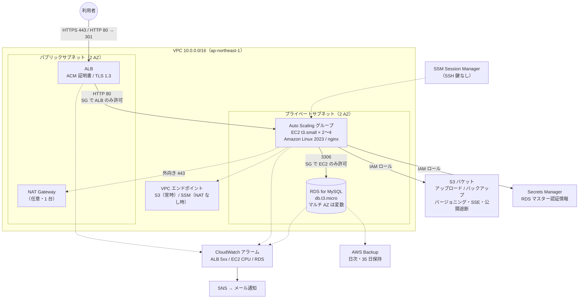

# AWS 小規模Webシステム構成テンプレート（Terraform）

> **自社制作のデモです（受託案件ではありません）。**
> TRIUNITECH が「インフラ・クラウド」サービスの参考構成として作成した
> Terraform テンプレートです。特定のお客様の環境や実績に基づくものではありません。

[](.github/workflows/validate.yml)

## 目次

1. [概要](#概要)
2. [構成図](#構成図)
3. [使い方](#使い方)
4. [変数一覧](#変数一覧)
5. [月額コスト目安](#月額コスト目安)
6. [運用手順書](#運用手順書)
7. [セキュリティ方針](#セキュリティ方針)
8. [制限事項](#制限事項)

---

## 概要

中小規模の Web アプリケーション（WordPress、PHP、Node.js など）を
AWS 上で安定して運用するための、**最小限かつ本番を想定した**構成を
Terraform で定義したものです。

| 項目 | 内容 |
|---|---|
| Terraform | `>= 1.6` |
| AWS Provider | `~> 5.0` |
| リージョン | `ap-northeast-1`（東京）既定、変数で変更可 |
| 構成 | 単一ルートモジュール（用途別にファイル分割） |

### 含まれるリソース

| ファイル | 内容 |
|---|---|
| `network.tf` | VPC、2 AZ のパブリック／プライベートサブネット、IGW、NAT Gateway（任意）、S3 ゲートウェイエンドポイント、NAT なし時の SSM 用エンドポイント |
| `alb.tf` | Application Load Balancer、HTTPS リスナー（ACM 証明書）、HTTP→HTTPS リダイレクト、ターゲットグループ |
| `compute.tf` | IAM インスタンスロール（SSM、CloudWatch Agent、S3、Secrets Manager）、起動テンプレート（Amazon Linux 2023、IMDSv2 必須、EBS 暗号化）、Auto Scaling グループ、CPU ターゲット追跡スケーリング |
| `database.tf` | RDS for MySQL（マルチ AZ は変数）、パラメータグループ（utf8mb4、スロークエリログ）、自動バックアップ 7 日、削除保護（変数）、パスワードは Secrets Manager で自動管理 |
| `storage.tf` | アップロード／バックアップ用 S3 バケット（バージョニング、SSE-S3、パブリックアクセス遮断、HTTPS 強制、旧バージョン 90 日で削除） |
| `monitoring.tf` | CloudWatch アラーム（ALB 5xx、ターゲット 5xx、異常ホスト数、EC2 CPU、RDS CPU／空きストレージ／接続数）→ SNS（メール通知） |
| `backup.tf` | AWS Backup（日次、35 日保持）による RDS の独立バックアップ |
| `outputs.tf` | ALB DNS 名、RDS エンドポイント、シークレット ARN、バケット名など |

### 含まれないもの（意図的）

- Route 53 のレコード（お客様のドメイン管理方法に依存するため）
- ACM 証明書の発行（DNS 検証が必要なため、事前に発行して ARN を渡します）
- WAF、CloudFront、ElastiCache（必要に応じて追加する前提）
- アプリケーション本体のデプロイ（`user_data` は nginx のプレースホルダーのみ）

---

## 構成図



---

## 使い方

### 前提

- Terraform 1.6 以上、AWS CLI、適切な権限を持つ AWS 認証情報
- 東京リージョンで発行済みの ACM 証明書（ALB 用）

### 手順

```bash
# 1. 変数ファイルを作成
cp terraform.tfvars.example terraform.tfvars
#    acm_certificate_arn と alarm_email を必ず書き換えてください

# 2. 初期化
terraform init

# 3. 事前確認（作成されるリソースを確認）
terraform plan -out=tfplan

# 4. 適用（通常 15〜20 分程度。RDS の作成に時間がかかります）
terraform apply tfplan

# 5. 出力を確認
terraform output
```

適用後、`alarm_email` に指定したアドレスへ SNS の確認メールが届きます。
**リンクを開いて承認しないと通知が届きません。**

ALB の DNS 名（`alb_dns_name`）を、お使いの DNS で
ALIAS または CNAME として設定すると、HTTPS でアクセスできます。

### 削除

```bash
# 削除保護を無効化してから削除
terraform apply -var="db_deletion_protection=false" -var="alb_deletion_protection=false"
terraform destroy
```

`db_skip_final_snapshot = false`（既定）の場合、削除時に最終スナップショットが作成されます。

### State の管理

既定ではローカルに `terraform.tfstate` を作成します。
チームで共有する場合は `versions.tf` 内のコメントを参考に
S3 バックエンド（＋ DynamoDB ロック）を設定してください。

---

## 変数一覧

### 基本

| 変数 | 型 | 既定値 | 説明 |
|---|---|---|---|
| `project_name` | string | `"smallweb"` | リソース名のプレフィックスとタグ |
| `environment` | string | `"prod"` | 環境名 |
| `aws_region` | string | `"ap-northeast-1"` | リージョン |
| `additional_tags` | map(string) | `{}` | 全リソースへの追加タグ |

### ネットワーク

| 変数 | 型 | 既定値 | 説明 |
|---|---|---|---|
| `vpc_cidr` | string | `"10.0.0.0/16"` | VPC CIDR |
| `public_subnet_cidrs` | list(string) | `["10.0.0.0/24","10.0.1.0/24"]` | パブリックサブネット（2 つ） |
| `private_subnet_cidrs` | list(string) | `["10.0.10.0/24","10.0.11.0/24"]` | プライベートサブネット（2 つ） |
| `enable_nat_gateway` | bool | `true` | NAT Gateway を作成。`false` の場合は SSM 用エンドポイントを作成 |

### ALB

| 変数 | 型 | 既定値 | 説明 |
|---|---|---|---|
| `acm_certificate_arn` | string | （必須） | HTTPS リスナーの ACM 証明書 ARN |
| `alb_allowed_cidrs` | list(string) | `["0.0.0.0/0"]` | ALB への接続を許可する CIDR |
| `alb_deletion_protection` | bool | `false` | ALB の削除保護 |
| `health_check_path` | string | `"/"` | ヘルスチェックパス |

### EC2 / Auto Scaling

| 変数 | 型 | 既定値 | 説明 |
|---|---|---|---|
| `instance_type` | string | `"t3.small"` | インスタンスタイプ |
| `asg_min_size` | number | `2` | 最小台数 |
| `asg_max_size` | number | `4` | 最大台数 |
| `asg_desired_capacity` | number | `2` | 希望台数（apply 後の手動変更は保持） |
| `root_volume_size` | number | `20` | ルートボリューム GiB |
| `cpu_target_utilization` | number | `60` | スケーリング目標 CPU % |

### RDS

| 変数 | 型 | 既定値 | 説明 |
|---|---|---|---|
| `db_engine_version` | string | `"8.0"` | MySQL バージョン（パラメータグループは `mysql8.0` 固定） |
| `db_instance_class` | string | `"db.t3.micro"` | インスタンスクラス |
| `db_name` | string | `"appdb"` | 初期 DB 名 |
| `db_username` | string | `"dbadmin"` | マスターユーザー名 |
| `db_allocated_storage` | number | `20` | 初期ストレージ GiB |
| `db_max_allocated_storage` | number | `100` | 自動拡張上限 GiB |
| `db_multi_az` | bool | `false` | マルチ AZ |
| `db_deletion_protection` | bool | `true` | 削除保護 |
| `db_skip_final_snapshot` | bool | `false` | 削除時の最終スナップショットをスキップ |
| `db_backup_retention_days` | number | `7` | 自動バックアップ保持日数 |
| `db_snapshot_identifier` | string | `""` | 復旧用スナップショット ID（指定で置き換え） |

### 監視

| 変数 | 型 | 既定値 | 説明 |
|---|---|---|---|
| `alarm_email` | string | `""` | 通知先メール（空なら購読を作成しない） |
| `ec2_cpu_alarm_threshold` | number | `80` | EC2 CPU アラーム % |
| `rds_cpu_alarm_threshold` | number | `80` | RDS CPU アラーム % |
| `rds_free_storage_alarm_threshold_bytes` | number | `2147483648` | RDS 空き容量アラーム（2 GiB） |
| `rds_connections_alarm_threshold` | number | `50` | RDS 接続数アラーム |

### AWS Backup

| 変数 | 型 | 既定値 | 説明 |
|---|---|---|---|
| `backup_retention_days` | number | `35` | 復旧ポイント保持日数 |
| `backup_schedule_cron` | string | `"cron(0 18 * * ? *)"` | 実行スケジュール（UTC、既定は JST 03:00） |

---

## 月額コスト目安

> **目安です。** 2026 年時点の東京リージョンのオンデマンド料金をもとにした概算で、
> 為替・料金改定・データ転送量・無料利用枠により変動します。
> 導入前に必ず [AWS Pricing Calculator](https://calculator.aws/) でご確認ください。

既定値（t3.small × 2、RDS db.t3.micro シングル AZ、NAT Gateway あり、
データ転送量が少ない場合）での概算です。

| 項目 | 構成 | 月額目安（USD） |
|---|---|---|
| EC2 | t3.small × 2、730 時間 | 約 40 |
| EBS | gp3 20 GiB × 2 | 約 4 |
| ALB | 固定料金 + 少量の LCU | 約 20〜25 |
| NAT Gateway | 1 台 + 少量の処理データ | 約 45〜50 |
| RDS for MySQL | db.t3.micro シングル AZ、gp3 20 GiB | 約 20〜25 |
| S3 | 数 GB + バージョニング | 約 1 |
| CloudWatch / SNS | アラーム 7 件 | 約 1 |
| AWS Backup | RDS スナップショット差分 35 日分 | 約 2〜5 |
| Secrets Manager | シークレット 1 件 | 約 0.5 |
| **合計** | | **約 135〜155 USD / 月** |

### 構成変更による増減（目安）

| 変更 | 影響 |
|---|---|
| RDS をマルチ AZ にする | RDS 分がおおよそ 2 倍 |
| NAT Gateway を無効化（`enable_nat_gateway = false`） | NAT 分は不要になりますが、代わりに SSM 用インターフェースエンドポイント（3 サービス × 2 AZ）の料金がかかるため、**削減効果は限定的**です。主に「外向き通信を遮断したい」場合の選択肢です |
| EC2 を 1 台に減らす | 約 20 USD 減（ただし冗長性は失われます） |
| 1 年のリザーブド / Savings Plans | EC2・RDS がおおよそ 3〜4 割減になることが多い |

---

## 運用手順書

### 1. 障害時の確認手順

アラームメールを受け取ったら、以下の順で確認します。

| 手順 | 確認内容 | 場所 |
|---|---|---|
| 1 | どのアラームか（ALB 5xx / ターゲット 5xx / 異常ホスト / CPU / RDS） | メール本文の `AlarmName` |
| 2 | ALB のターゲットの健全性 | EC2 → ターゲットグループ → Targets タブ |
| 3 | EC2 インスタンスの状態、直近の起動・終了 | EC2 → Auto Scaling グループ → アクティビティ |
| 4 | インスタンスへ接続してログを確認（SSH 不要） | Systems Manager → Session Manager → 接続 → `sudo journalctl -u nginx`、`/var/log/nginx/error.log` |
| 5 | RDS の状態、CPU、接続数、空き容量 | RDS → インスタンス → モニタリング |
| 6 | RDS のエラーログ・スロークエリログ | CloudWatch Logs → `/aws/rds/instance/<識別子>/error`、`/slowquery` |
| 7 | 直近の変更（Terraform apply、デプロイ、AWS 側のイベント） | `terraform plan` に差分がないか、AWS Health Dashboard |

**よくある対処**

- ターゲットが 1 台だけ異常 → ASG が自動で置き換えます。置き換わらない場合は該当インスタンスを「終了」すると再作成されます。
- 全ターゲットが異常 → アプリ側の問題の可能性が高いため、Session Manager で接続してアプリのログを確認します。
- RDS 空き容量不足 → `db_max_allocated_storage` の範囲で自動拡張されます。上限に達している場合は値を増やして `terraform apply`。
- RDS 接続数過多 → アプリのコネクションプール設定を確認。恒常的なら `db_instance_class` を上げます。

### 2. バックアップからの復旧手順

バックアップは 2 系統あります。

| 系統 | 保持 | 用途 |
|---|---|---|
| RDS 自動バックアップ | 7 日 | 任意の時点（ポイントインタイム）への復旧 |
| AWS Backup（保管庫 `<project>-<env>-vault`） | 35 日 | 日次スナップショットからの復旧、長期保持 |

**手順（スナップショットから復旧する場合）**

1. RDS コンソール → スナップショット（または AWS Backup → 保管庫）で復旧元を選び、
   **新しい識別子**（例: `smallweb-prod-db-restore-20260401`）で復元します。
   ポイントインタイム復旧の場合は RDS → インスタンス → アクション → 「特定時点に復元」を使います。
2. 復元されたインスタンスに Session Manager 経由の EC2 から接続し、データを確認します。
3. 問題なければ、本番へ切り替えます。方法は 2 つあります。

   **方法 A（Terraform で置き換える・推奨）**
   復元したインスタンスからスナップショットを取得し、その ID を `db_snapshot_identifier` に指定して
   `terraform apply` します。既存の RDS は削除され、スナップショットから再作成されます。
   `db_deletion_protection = true` の場合は先に `false` にして apply が必要です。
   作業前に現行 DB の手動スナップショットを必ず取得してください。

   **方法 B（アプリの接続先だけ切り替える・緊急時）**
   アプリの接続先を復元インスタンスのエンドポイントに変更して即時復旧し、
   後日、方法 A で Terraform 管理下に戻します。

4. 復旧後、`terraform plan` で差分がないことを確認し、アラームが OK に戻っていることを確認します。

### 3. スケール変更手順

| 変更したいこと | 変数 | 反映方法・注意 |
|---|---|---|
| EC2 の台数 | `asg_min_size` / `asg_max_size` / `asg_desired_capacity` | `terraform apply`。`desired_capacity` は手動変更を保持する設定のため、Terraform で戻したい場合はコンソールで変更後に apply |
| EC2 のサイズ | `instance_type` | 起動テンプレートが更新され、ASG のローリング更新（50% ずつ）で入れ替わります。無停止 |
| RDS のサイズ | `db_instance_class` | `apply_immediately = false` のため次のメンテナンスウィンドウ（日曜 JST 04:00〜05:00）で反映。即時反映したい場合は `database.tf` の `apply_immediately` を一時的に `true` に。シングル AZ では数分の停止あり |
| RDS をマルチ AZ 化 | `db_multi_az = true` | メンテナンスウィンドウで反映。短時間の I/O 停止あり |
| RDS ストレージ上限 | `db_max_allocated_storage` | 即時反映、無停止 |
| 一時的な負荷対応 | コンソールで ASG の希望台数を変更 | Terraform 側は `ignore_changes` のため巻き戻りません |

---

## セキュリティ方針

| 方針 | 実装 |
|---|---|
| **SSH を使わない** | EC2 にキーペアを設定せず、SSM Session Manager で接続。セキュリティグループに 22 番の許可なし |
| **最小権限のセキュリティグループ** | ALB → EC2 は 80 番のみ、EC2 → RDS は 3306 のみ、すべて SG 参照で許可（CIDR ではなく） |
| **EC2 はプライベートサブネット** | パブリック IP を付与せず、外向きは NAT または VPC エンドポイント経由 |
| **IMDSv2 必須** | 起動テンプレートで `http_tokens = "required"`、ホップ制限 1 |
| **暗号化** | EBS、RDS ストレージ、S3（SSE-S3）をすべて暗号化 |
| **認証情報を tfstate に残さない** | RDS のマスターパスワードは `manage_master_user_password` により Secrets Manager で生成・管理。EC2 は IAM ロールで取得 |
| **S3 公開遮断** | パブリックアクセスブロック 4 項目すべて有効、HTTPS 以外の通信を拒否するバケットポリシー、ACL 無効化 |
| **TLS** | ALB で TLS 1.2 / 1.3 のみ（`ELBSecurityPolicy-TLS13-1-2-2021-06`）、HTTP は 301 で HTTPS へ |
| **IAM** | インスタンスロールは SSM、CloudWatch Agent、対象バケットのみ、対象シークレットのみ。AWS Backup はサービスロールを分離 |
| **削除保護・バックアップ** | RDS 削除保護（既定 ON）、最終スナップショット、自動バックアップ 7 日 + AWS Backup 35 日、S3 バージョニング |
| **タグ** | `default_tags` で Project / Environment / ManagedBy を全リソースに付与し、コスト配分と棚卸しを容易に |

---

## 制限事項

- **デモ用テンプレートです。** 実運用に入れる前に、お客様の要件（可用性、RPO/RTO、監査、ログ保持期間）に合わせた見直しが必要です。
- `user_data` は nginx のプレースホルダーのみで、アプリケーション（WordPress 等）のデプロイは含みません。実運用ではゴールデン AMI または CodeDeploy 等との組み合わせを想定しています。
- NAT Gateway は 1 台構成です。NAT を置いた AZ に障害が起きると、プライベートサブネットからの外向き通信が止まります（ALB → EC2 → RDS の経路は影響を受けません）。AZ ごとに NAT を置く場合はコストが 2 倍になります。
- `db_engine_version` を 8.4 系などに変更する場合、`database.tf` のパラメータグループの `family` も合わせて変更してください。
- ALB のアクセスログ、VPC フローログ、CloudTrail、GuardDuty、WAF は含みません。監査要件がある場合は追加が必要です。
- CloudWatch アラームのしきい値は一般的な初期値です。本番の負荷に合わせて調整してください。
- 本テンプレートは `terraform fmt` / `terraform validate` による静的検査を前提としており、実際の AWS アカウントでの `apply` 結果を保証するものではありません。

---

## ライセンス・連絡先

本テンプレートは TRIUNITECH が参考構成として公開しているものです。ライセンスは Apache License 2.0 です（[LICENSE](LICENSE) をご参照ください）。
ご質問は admin@triunitech.com までお願いいたします（1 営業日以内にご返答いたします）。

- Web: https://www.triunitech.com
- 構成図のみ: [docs/architecture.md](docs/architecture.md)
