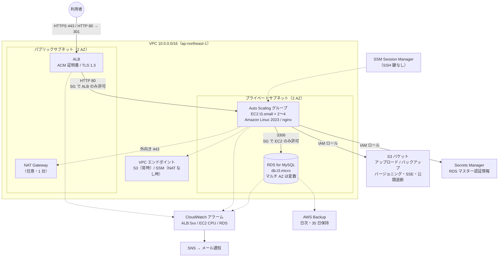
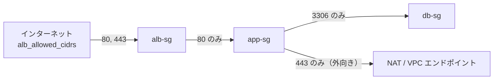
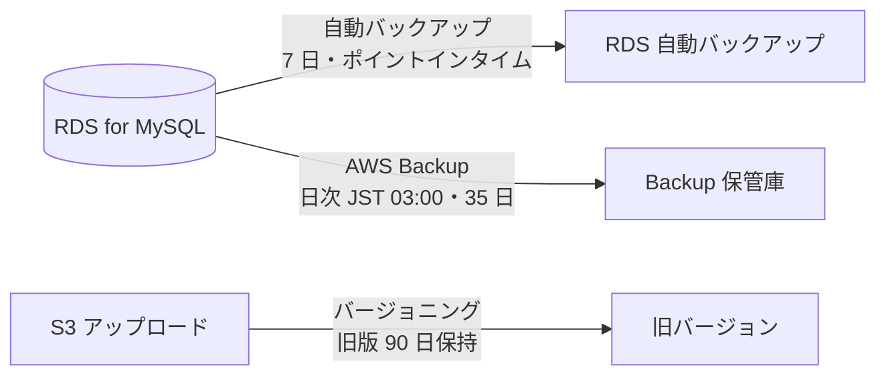

# 構成図 — AWS 小規模Webシステム構成テンプレート

> 自社制作のデモです（受託案件ではありません）。

## 全体構成

## 通信経路とセキュリティグループ

- `alb-sg`: 受信 80/443（許可 CIDR から）、送信は `app-sg` の 80 のみ
- `app-sg`: 受信は `alb-sg` からの 80 のみ、送信は 443（SSM、パッケージ取得、AWS API）と `db-sg` の 3306 のみ
- `db-sg`: 受信は `app-sg` からの 3306 のみ、送信なし

## バックアップ系統

詳細は [README.md](../README.md) の「運用手順書」をご参照ください。
